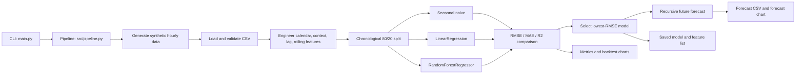
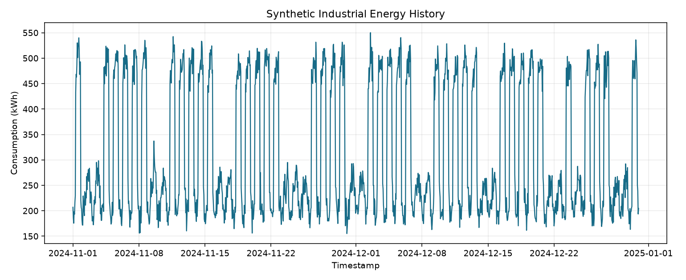
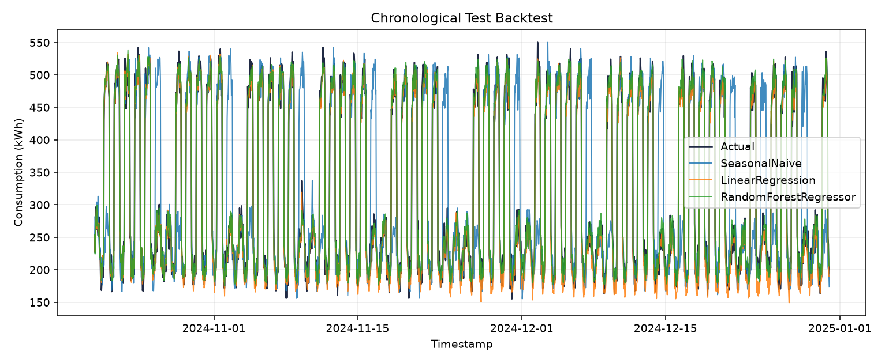
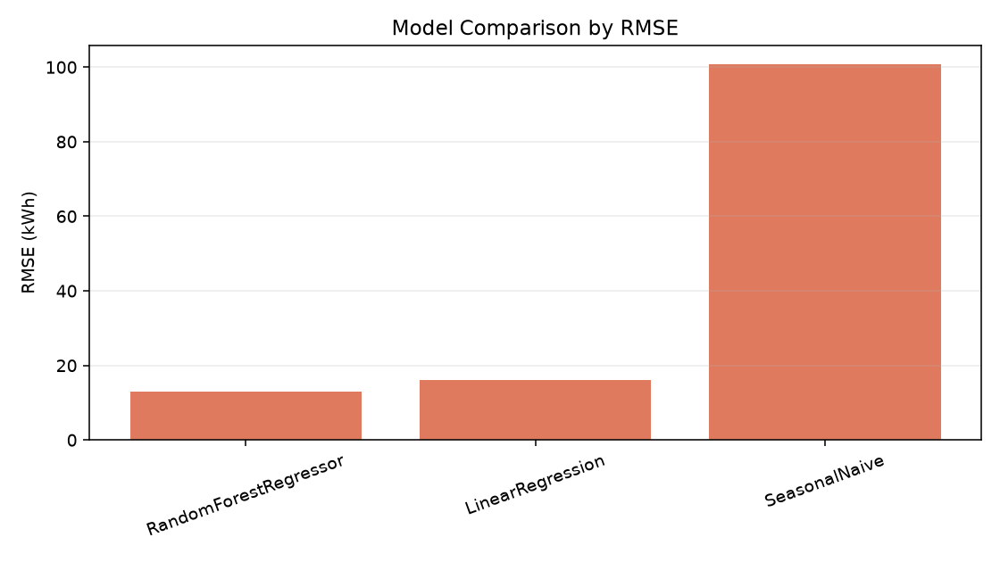
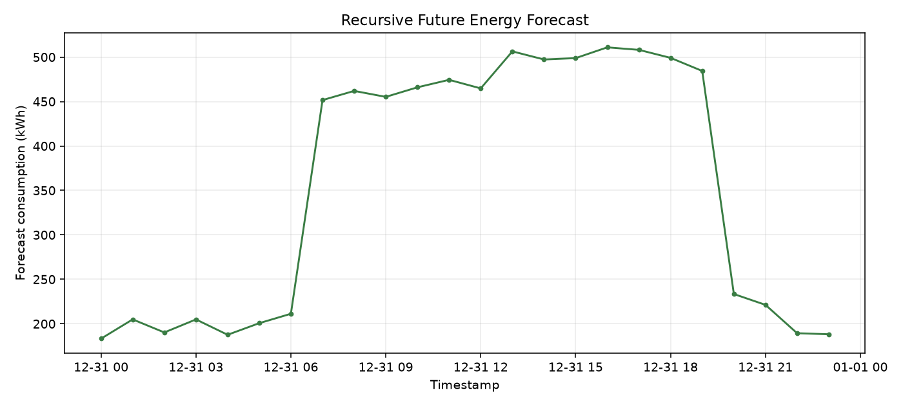
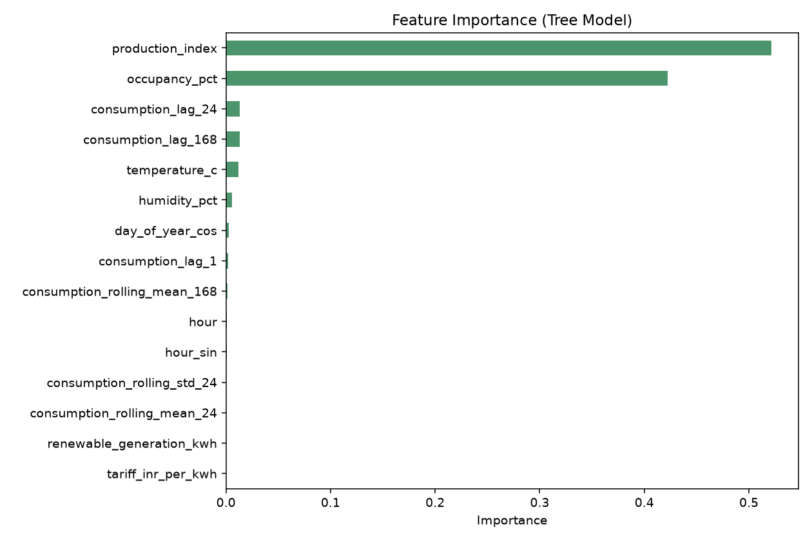

# AI-Powered Energy Consumption Forecasting System

[](https://www.python.org/)
[](#verification)
[](#)

> **Badge placeholders:** Replace the test, coverage, and license badge URLs with the
> repository's real CI and licensing links when this project is published. The
> badges above deliberately do not claim that a CI workflow or a license exists yet.

## Overview

This project is a beginner-friendly, end-to-end demonstration of hourly industrial
energy-consumption forecasting. It generates a deterministic synthetic data set,
creates calendar/weather/operations/lag features, compares three forecasting
approaches, evaluates them on the last 20% of the timeline, saves the best model,
and produces a recursive forecast for future hours.

The project is intentionally self-contained. It uses a **virtual simulation**, not a
utility feed, factory historian, smart-meter export, or corporate data warehouse. No
network connection or private data is required. With the same command and seed, the
same simulated history and future-driver values can be regenerated.

## Problem statement

Industrial sites consume different amounts of electricity during shifts, weekends,
holidays, peak-tariff periods, hot or cold weather, and periods of on-site renewable
generation. A site operator may want a short-term estimate of the next 24 hourly
consumption values so that they can investigate demand peaks, schedule flexible loads,
compare a production plan with expected demand, or discuss a demand-response option.

The learning problem is:

> Given historical hourly energy consumption and known or simulated context, estimate
> the next hourly energy demand without using future target values during a real
> forecast.

This repository demonstrates the data and modeling workflow around that problem. It
does not provide a grid-control product, a billing system, or an operational decision
that should be applied without domain review.

## The idea in simple language

1. Create a realistic-looking hourly history for an industrial facility.
2. Add clues such as hour of day, day of week, temperature, occupancy, production,
   renewable generation, tariff, holidays, and recent consumption.
3. Keep the final 20% of time as a chronological test period.
4. Compare a seasonal-naive rule, linear regression, and random forest regression.
5. Pick the model with the lowest test RMSE.
6. Predict the next 24 hours recursively: each prediction becomes part of the lag
   history used for the following hour.
7. Save metrics, forecasts, the selected estimator, feature names, and PNG charts.

## Technical explanation

`src/data_generator.py` creates `24 * days` rows starting at `2024-01-01` with
deterministic pseudo-random noise. The target is `consumption_kwh`. The synthetic
signal combines a base industrial load, HVAC-like temperature effects, production and
occupancy load, tariff response, a daily cycle, an on-site renewable offset, and
noise.

`src/features.py` adds calendar encodings, weather and operational variables, one-
hour/24-hour/168-hour target lags, and rolling statistics. Rolling windows are shifted
before aggregation so a row does not use its current target as an input.

`src/modeling.py` evaluates:

- **SeasonalNaive:** the observed value from 24 hours earlier.
- **LinearRegression:** a linear model over the engineered features.
- **RandomForestRegressor:** a seeded ensemble of decision trees.

The split is chronological: the first 80% of engineered rows are training data and the
final 20% are the one-step-ahead backtest. The winner is selected by lowest RMSE, with
MAE and R² reported as additional context. Future forecasting is recursive and uses
simulated future exogenous drivers; it feeds each prediction into the next row's lag
features.

## Industry use cases

These are potential applications of the pattern, not claims that this repository is
connected to any organization:

- **Smart cities:** estimate aggregate demand patterns for planning dashboards and
  energy-efficiency studies.
- **Utilities and electricity boards:** prototype short-term load forecasting,
  peak-awareness views, and demand-response analysis before integrating approved
  meter data.
- **Manufacturing:** explore the relationship between production schedules, shifts,
  weather, tariffs, and facility demand.
- **Data centers:** model cooling and workload-related demand and test what-if
  scenarios using appropriately governed telemetry.
- **Renewable companies:** study how simulated solar generation may offset facility
  demand and affect a short-term forecast.

## Business value

A validated forecasting workflow can help a team ask better operational questions:

- When are likely demand peaks, and how uncertain are they?
- Would a planned production or shift change coincide with a high-demand period?
- How might on-site generation change net grid consumption?
- Which input signals should be collected before building a production-grade model?
- Is a complex model meaningfully better than a transparent baseline?

The value in this educational project is the repeatable evidence trail: a declared
simulation, an explicit time split, comparable metrics, saved artifacts, and charts
that make errors inspectable. A business deployment would also need real data quality,
forecast availability, monitoring, access controls, cost validation, and human
approval.

## Features

- Deterministic synthetic hourly industrial data with a configurable number of days.
- Configurable future horizon and random seed from `main.py`.
- Calendar, cyclical, weather, operations, lag, and rolling features.
- Seasonal-naive, linear-regression, and random-forest comparison.
- Chronological 80/20 holdout instead of a random split.
- RMSE, MAE, and R² evaluation with model selection by RMSE.
- Recursive future forecasting with deterministic simulated exogenous drivers.
- JSON and CSV metric reports, a future forecast CSV, a saved estimator, a feature
  list, and diagnostic PNGs.
- Fast tests for schema, feature completeness, chronological splitting, and an
  isolated end-to-end run.

## Architecture



The same flow in words is: **simulate -> validate -> engineer -> backtest -> select ->
forecast -> save -> visualize**.

## Folder structure

```text
AI-Powered Energy Consumption Forecasting/
├── README.md
├── requirements.txt
├── .gitignore
├── main.py
├── src/
│   ├── config.py
│   ├── data_generator.py
│   ├── features.py
│   ├── modeling.py
│   ├── visualization.py
│   └── pipeline.py
├── tests/
│   └── test_pipeline.py
├── data/
│   └── README.md
├── models/
│   └── README.md
├── outputs/
│   └── README.md
├── images/
│   └── README.md
├── notebooks/
│   └── README.md
└── docs/
    ├── ARCHITECTURE.md
    └── DETAILED_GUIDE.md
```

Runtime commands populate the data, model, output, and image directories. The README
files in those directories explain the generated artifacts without requiring a
generated dataset to be committed in advance.

## Tech stack

| Area | Choice | Why it is used |
| --- | --- | --- |
| Language | Python 3.10+ | Readable scripting and broad data-science support |
| Tabular data | pandas | Time-series tables, CSV I/O, and feature preparation |
| Numerical work | NumPy | Deterministic random generation and vectorized formulas |
| Models | scikit-learn | Linear regression, random forest, and metrics |
| Persistence | joblib | Save and reload the selected fitted estimator |
| Charts | Matplotlib and seaborn | Headless PNG output and familiar plotting APIs |
| Tests | pytest | Fast regression checks and an isolated pipeline run |

Exact dependency ranges are in `requirements.txt`.

## Dataset and simulation description

The default command creates one row per hour for 365 days (`8,760` raw rows). The
generator uses a fixed start timestamp and a NumPy random generator seeded from the
CLI. It simulates:

| Column | Meaning | Unit/type |
| --- | --- | --- |
| `timestamp` | Hour of the observation | UTC-naive datetime |
| `temperature_c` | Ambient temperature proxy | °C |
| `humidity_pct` | Relative humidity proxy | percent |
| `occupancy_pct` | Facility occupancy proxy | percent |
| `production_index` | Production activity proxy | unitless index |
| `renewable_generation_kwh` | On-site renewable output proxy | kWh per hour |
| `tariff_inr_per_kwh` | Time-varying price proxy | INR/kWh in the simulation |
| `is_holiday` | Holiday indicator | boolean |
| `consumption_kwh` | Energy consumed by the facility | kWh per hour |

The holiday dates, working hours, solar profile, tariff peak period, and noise are
assumptions in code. They are useful for learning feature engineering but are not a
calendar, weather service, tariff schedule, or plant measurement. Future driver values
are simulated again for the forecast horizon, so the 24-hour forecast is a virtual
what-if result rather than a claim about tomorrow's weather or production.

## Installation

Run all commands from the project root.

### Windows PowerShell

```powershell
py -3 -m venv .venv
.\.venv\Scripts\Activate.ps1
python -m pip install --upgrade pip
python -m pip install -r requirements.txt
```

If PowerShell blocks activation, either allow the local script for the current user
with the normal Windows Python guidance or use Command Prompt:

```bat
py -3 -m venv .venv
.venv\Scripts\activate.bat
python -m pip install --upgrade pip
python -m pip install -r requirements.txt
```

### macOS and Linux

```bash
python3 -m venv .venv
source .venv/bin/activate
python -m pip install --upgrade pip
python -m pip install -r requirements.txt
```

Verify the environment before running the pipeline:

```bash
python --version
python -c "import numpy, pandas, sklearn, joblib, matplotlib, seaborn; print('dependencies OK')"
python -m pytest -q
```

## Usage

From the repository root, the full reproducible run is:

```bash
python main.py --days 365 --forecast-horizon 24 --seed 42
```

For a faster learning run:

```bash
python main.py --days 30 --forecast-horizon 24 --seed 42
```

The command prints the selected model, metric file locations, forecast row count, and
the number of generated charts. The full pipeline should be run with enough history
for the 168-hour lag features; the supplied 30-day example provides that history.

Run the tests with:

```bash
python -m pytest -q
```

## Expected outputs

### Requested artifact names

The project documentation uses the following proof-of-work artifact contract:

| Path | Contents |
| --- | --- |
| `data/energy_consumption.csv` | Deterministic hourly synthetic history, including the raw context columns and `consumption_kwh` |
| `outputs/metrics.json` | Selected model, run parameters, train/test counts, backtest note, and RMSE/MAE/R² for all three models |
| `outputs/metrics.csv` | One row per model with `model`, `rmse`, `mae`, and `r2` columns |
| `outputs/forecast.csv` | Future timestamps, simulated exogenous drivers, and recursive `consumption_kwh` predictions |
| `models/best_model.joblib` | Fitted estimator selected by lowest chronological-test RMSE |
| `models/feature_columns.json` | Ordered feature names used by the supervised estimators |
| `images/energy_history.png` | Recent synthetic history plot |
| `images/actual_vs_predicted.png` | Chronological test actuals and model predictions |
| `images/model_comparison.png` | RMSE comparison bar chart |
| `images/future_forecast.png` | Recursive future forecast chart |
| `images/feature_importance.png` | Top tree-model feature importances; the current candidate set includes RandomForestRegressor, so a normal run produces this chart |

Do not invent metric values in a report. Read the generated JSON/CSV files after a run
and describe the observed values.

### Artifact naming

The source configuration uses the public artifact names listed above, so the paths in the table are the paths produced by a normal run.

## How to interpret evaluation

The last 20% of engineered rows are held out in time order. This mimics the basic
question, “Can a model trained on the past estimate a later period?” It is not a
random split, which would mix future and past patterns.

- **RMSE (kWh):** square-root average squared error. Lower is better; large misses are
  penalized more strongly.
- **MAE (kWh):** average absolute error. Lower is better and easier to explain as a
  typical magnitude of miss.
- **R²:** variance explained relative to a constant mean predictor. Higher is usually
  better, but it can be negative when predictions are worse than that baseline.

The selected model is the model with the lowest RMSE in the chronological backtest.
The seasonal-naive result is an important reference point: a more complex model is
only useful if it improves on a simple daily-seasonality rule under the same split.
The backtest uses observed target lags for one-step-ahead evaluation. The future path
is different: it is recursive and feeds predictions back into future lag features.
That distinction should be included in any serious interpretation of the metrics.

### Observed verification run

The following values were read from the full local run using
`python main.py --days 365 --forecast-horizon 24 --seed 42` in this workspace. They are
sample evidence for the exact command and dependency environment, not a promise about a
real facility or every future run.

| Model | RMSE (kWh) | MAE (kWh) | R² |
| --- | ---: | ---: | ---: |
| SeasonalNaive | 100.7901 | 57.0275 | 0.4202 |
| LinearRegression | 16.1518 | 12.8168 | 0.9851 |
| RandomForestRegressor | 13.0188 | 10.3212 | 0.9903 |

The selected model was `RandomForestRegressor`; the engineered backtest contained 6,873
training rows and 1,719 test rows, and the future forecast contained 24 rows.

## Screenshots and generated images

After a successful run, add the PNGs to a report, a GitHub README image section, or a
portfolio page with captions that state they are simulated data:

1. `images/energy_history.png` — hourly synthetic history, usually the trailing 60
   days or all history when shorter.
2. `images/actual_vs_predicted.png` — actual versus each model in the chronological
   test window.
3. `images/model_comparison.png` — RMSE bars for SeasonalNaive, LinearRegression,
   and RandomForestRegressor.
4. `images/future_forecast.png` — the requested future horizon from the selected
   model.
5. `images/feature_importance.png` — top random-forest feature importances. The
   current pipeline includes RandomForestRegressor, so this chart is normally created;
   it is conditional only if the plotting inputs or candidate set are changed.

Example Markdown for a future GitHub page:

```markdown
## Screenshots






```

## Reproducibility

Use the same Python dependency ranges, command, and seed to reproduce the same
simulation:

```bash
python main.py --days 365 --forecast-horizon 24 --seed 42
```

The seed controls synthetic history, seeded random forest construction, and future
exogenous-driver simulation. `days` changes the available history and therefore the
number of train/test rows after lag preparation. `forecast-horizon` changes only the
future forecast length. Re-running regenerates the CSV and overwrites runtime
artifacts at the configured paths; copy artifacts elsewhere if you need to preserve a
run for comparison.

## Limitations and ethics

- **Virtual data only:** no conclusion in this repository is evidence about a real
  plant, city, utility, tariff, weather pattern, or renewable asset.
- **Synthetic relationships:** the generator embeds relationships between drivers and
  demand, so performance may look better or more stable than on messy real data.
- **Simulated future inputs:** the recursive forecast assumes future exogenous values
  can be simulated. A real deployment needs a documented source and availability
  time for weather, production, occupancy, tariffs, holidays, and generation.
- **Backtest scope:** one chronological holdout is useful for learning but is not a
  complete rolling-origin validation, uncertainty interval, drift test, or production
  acceptance gate.
- **Lag availability:** a real-time system must confirm that every feature is known at
  forecast time and must handle missing, delayed, or revised measurements.
- **Metric trade-offs:** optimizing RMSE alone may not match the cost of a peak error,
  under-forecast, or over-forecast. Business costs should be made explicit.
- **Fairness and governance:** site-level monitoring should respect privacy, access
  controls, worker protections, and data-minimization rules. Occupancy should not be
  used to make personnel decisions.
- **Safety:** do not connect this demo directly to breakers, dispatch controls,
  billing, or automated production changes. Human review and domain validation are
  required.

## Upload to GitHub

These commands are instructions for the project owner to run after reviewing the
files. This task does not initialize a repository, commit, or push anything.

```bash
git init
git add README.md requirements.txt .gitignore main.py src/ tests/ docs/ data/README.md models/README.md outputs/README.md images/README.md notebooks/README.md data/energy_consumption.csv outputs/metrics.json outputs/metrics.csv outputs/forecast.csv images/*.png
git status
git commit -m "docs: document synthetic energy forecasting project"
git branch -M main
git remote add origin https://github.com/<YOUR-USERNAME>/<YOUR-REPOSITORY>.git
git push -u origin main
```

If source and tests are already present and should be part of the repository, review
`git status` and add them intentionally rather than relying on `git add .`. Never add
API keys, passwords, `.env` files, private exports, or unreviewed proprietary data.

## Suggested commit strategy

Small commits make the proof of work easier to follow:

1. `chore: add Python dependency ranges and ignore rules`
2. `docs: explain data simulation and generated artifacts`
3. `docs: add architecture and detailed implementation guide`
4. `test: verify deterministic pipeline artifacts` (only when a meaningful test
   change is actually made)
5. `docs: add screenshots and observed run metrics` (after running the pipeline and
   reviewing the files)

Commit the synthetic CSV, metrics, forecast, and PNGs only when they are intentionally
   part of the portfolio evidence. Keep generated model binaries out of Git unless
   there is a specific, reviewed reason; `.gitignore` excludes them by default.

## Learning outcomes

By completing this project, a learner can practice:

- turning a business question into a reproducible time-series experiment;
- generating and validating a deterministic data set;
- separating known exogenous inputs from target history;
- creating calendar, cyclical, lag, and rolling features;
- avoiding random train/test splits for time-ordered data;
- comparing a baseline with interpretable and nonlinear models;
- reading RMSE, MAE, and R² without hiding the split assumptions;
- implementing recursive multi-step forecasting;
- saving models, feature metadata, metrics, and visual evidence;
- writing tests and documentation that let another person rerun the work.

## Resume and portfolio bullet points

Use only statements that match the work you actually complete and can demonstrate:

- Built a reproducible Python pipeline that simulates hourly industrial energy demand,
  engineers calendar/weather/operations/lag features, and forecasts a configurable
  future horizon.
- Compared seasonal-naive, linear-regression, and random-forest regressors with a
  chronological 80/20 backtest using RMSE, MAE, and R²; selected the lowest-RMSE
  estimator.
- Implemented recursive multi-step forecasting with seeded simulated exogenous
  drivers and generated auditable CSV, JSON, joblib, feature-list, and PNG artifacts.
- Added pytest coverage for data schema, lag-feature completeness, time ordering, and
  an isolated end-to-end run; documented reproducibility and simulation limitations.

## A short 7-day proof-of-work plan

| Day | Evidence to produce | Suggested commit |
| --- | --- | --- |
| 1 — Setup | Environment, dependency installation, architecture notes, and passing tests. | `chore: set up reproducible Python environment` |
| 2 — Dataset | 30-day synthetic CSV, schema preview, row count, and reproducibility check. | `feat: add deterministic synthetic energy dataset` |
| 3 — Preprocessing | Cleaning notes, calendar features, lag/rolling features, and leakage explanation. | `feat: add preprocessing and time features` |
| 4 — Model | Seasonal-naive, LinearRegression, and RandomForest training path. | `feat: train baseline and machine learning models` |
| 5 — Evaluation | Metrics JSON/CSV, chronological split evidence, and model-selection explanation. | `test: add chronological evaluation and metrics` |
| 6 — Visualization | Forecast CSV, five PNG charts, captions, and business interpretation. | `feat: generate forecasts and visual proof` |
| 7 — Upload | README polish, explicit staging review, GitHub repository, topics, and demo proof. | `docs: publish GitHub-ready project` |

## Verification and troubleshooting

- Run from the repository root so relative paths resolve to the expected folders.
- Use Python 3.10 or newer; the source uses modern type annotations.
- If imports fail, activate `.venv` and reinstall `requirements.txt`.
- If a short custom run fails around lag creation, use at least eight days of history;
  the documented 30-day run is the safe small example.
- If a chart does not appear, inspect the `images/` directory; plotting uses a
  headless backend and writes files instead of opening a window.
- If output filenames differ from the contract, inspect `src/config.py` and the files
  created by the exact command before describing the run.
