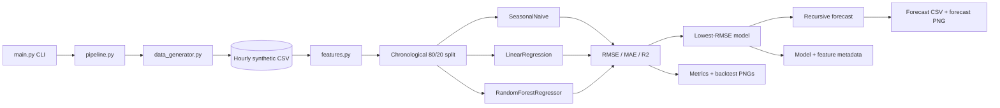

# Architecture

## System diagram

## Data flow

1. `main.py` parses `days`, `forecast-horizon`, and `seed`.
2. `data_generator.py` creates deterministic hourly context and
   `consumption_kwh`, writes a CSV, then reloads and validates it.
3. `features.py` adds calendar/cyclical, weather, operational, lag, and shifted
   rolling features. Rows without the 168-hour history are removed.
4. `modeling.py` keeps time order, trains the SeasonalNaive, LinearRegression, and
   RandomForestRegressor candidates, and calculates RMSE, MAE, and R².
5. The lowest-RMSE candidate is saved and used for a recursive future forecast. Future
   weather, operations, renewable generation, tariff, and holiday values are simulated.
6. `pipeline.py` writes metrics, forecast data, model/feature metadata, and charts.

## Module responsibilities

| Module | Responsibility |
| --- | --- |
| `src/config.py` | Repository-relative directories, artifact paths, defaults, target/timestamp constants. |
| `src/data_generator.py` | Deterministic history generation and CSV validation. |
| `src/features.py` | Time, context, lag, and rolling features plus ordered model columns. |
| `src/modeling.py` | Chronological split, candidate estimators, metrics, persistence, future-driver simulation, recursive forecasting. |
| `src/visualization.py` | Headless PNG generation for history, backtest, comparison, forecast, and conditional tree importance. |
| `src/pipeline.py` | End-to-end orchestration and artifact serialization. |
| `main.py` | User-facing command-line entry point. |

## Assumptions

- Observations are hourly and initially sorted by timestamp.
- The simulator starts at `2024-01-01` and generates `24 * days` rows.
- A 24-hour seasonal lag is a useful baseline and a 168-hour history is available for
  the longest feature window.
- The final 20% is an appropriate simple holdout for this learning exercise.
- Exogenous drivers for the future can be simulated deterministically.
- `tariff_inr_per_kwh` is a fictional INR-denominated proxy, not a live tariff.
- Forecast values are non-negative, but no uncertainty interval is produced.

## Leakage and backtesting note

Rolling features are shifted before aggregation, so an engineered row does not include
its current target. The chronological split prevents later rows from entering the
training set. The backtest is one-step-ahead and uses observed target lags for the test
rows. The future forecast is recursive: after the first future prediction, predicted
consumption supplies later lag values. These paths are not equivalent. A production
study should add rolling-origin evaluation, verify that each exogenous input is actually
available at forecast time, and compare forecast errors over multiple periods.

## Artifact naming

The source configuration produces `data/energy_consumption.csv`, `models/best_model.joblib`, and `models/feature_columns.json`, matching the public documentation contract.

## Extension ideas

- Add rolling-origin and season-aware cross-validation.
- Add prediction intervals or quantile models rather than point forecasts only.
- Replace the simulator with a documented real-data adapter and data-quality checks.
- Add external weather, calendar, tariff, production-plan, and generation forecasts
  with explicit availability timestamps.
- Compare gradient boosting or other models only after a fair baseline comparison.
- Add experiment metadata, model versioning, and a reproducible run manifest.
- Monitor drift, missingness, latency, and under/over-forecast costs.
- Add a small API or dashboard behind authentication and human approval.
- Protect occupancy and production data with minimization, access controls, and audit
  logs.
