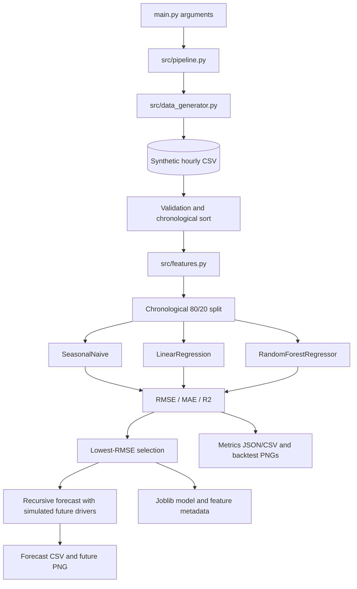

# Detailed Guide: AI-Powered Energy Consumption Forecasting

This guide is a learning path for someone who wants to understand, run, verify, and
explain the project. Read the **Simple language** paragraph first, then the
**Technical language** paragraph when you want the implementation detail. The system
described here is a **virtual simulation**, not a corporate energy platform and not a
production deployment.

## A. Project explanation

### Simple language

Imagine an industrial site that wants to know how much energy it might use during each
of the next 24 hours. We do not have a real plant meter, so the project creates a
repeatable fictional plant. It gives that plant realistic-looking weather, production,
occupancy, tariff, renewable-generation, and consumption patterns. A program learns
from the earlier hours and estimates the later hours.

### Technical language

The repository implements an hourly regression-forecasting pipeline. It generates a
deterministic `pandas.DataFrame`, writes and reloads a CSV, engineers features without
using the current target in rolling windows, performs a chronological 80/20 holdout,
trains three candidate approaches, calculates RMSE/MAE/R², chooses the lowest-RMSE
model, and performs a recursive forecast with simulated future drivers.

### Sample business scenario

Suppose a simulated manufacturing plant runs its main production shift from 07:00 to
19:00 on weekdays. Its HVAC demand rises on hotter days, a tariff is higher from
09:00 to 17:00, and solar generation reduces grid demand around midday. A planner could
use the demo to ask whether tomorrow's simulated demand has a peak worth investigating.
The forecast is evidence for a conversation, not an automatic instruction to change a
production schedule or operate electrical equipment.

### Common mistakes and verification

- **Mistake:** describing the data as a real factory or utility export.  
  **Verify:** every report says “synthetic,” “simulated,” and “virtual.”
- **Mistake:** presenting one metric as a guarantee.  
  **Verify:** include the split, seed, horizon, and backtest note with any metric.
- **Mistake:** assuming a saved model makes the system production-ready.  
  **Verify:** list missing monitoring, real input availability, uncertainty, security,
  and governance work.

## B. Tech stack options and selected approach

### Option A — Easiest: Python script plus scikit-learn (selected)

| Item | Choice |
| --- | --- |
| Tools | Python, pandas, NumPy, Matplotlib, seaborn, scikit-learn, joblib, pytest |
| Models | Seasonal-naive baseline, LinearRegression, RandomForestRegressor |
| Difficulty | Beginner-friendly |
| GPU | Not required; CPU is enough |
| Expected output | Clean CSV, metrics JSON/CSV, selected model metadata, five PNG charts, 24-hour forecast |

This is the selected approach because it is lightweight, reproducible, easy to run from a terminal, and clear enough for a beginner to trace from `main.py` into `src/`. It gives strong GitHub proof without hiding the workflow behind a large framework.

### Option B — Intermediate: statistical time-series notebook

| Item | Choice |
| --- | --- |
| Tools | Python, pandas, NumPy, Jupyter, statsmodels, scikit-learn, Matplotlib/seaborn |
| Models | ARIMA/SARIMA or SARIMAX plus RandomForest/GradientBoosting comparison |
| Difficulty | Intermediate |
| GPU | Not required |
| Expected output | Rolling-origin backtests, confidence intervals, seasonal diagnostics, and a forecast report |

Choose this when you already understand the baseline pipeline and want stronger classical time-series reasoning. It introduces stationarity, differencing, seasonal orders, residual diagnostics, and exogenous regressors. It is not included in the selected `requirements.txt` because the working project does not need `statsmodels`.

### Option C — Advanced: deep-learning forecasting service

| Item | Choice |
| --- | --- |
| Tools | Python, pandas, PyTorch or TensorFlow, Docker, MLflow, FastAPI, a scheduler, monitoring |
| Models | LSTM/GRU, Temporal Convolutional Network, Temporal Fusion Transformer, or a hybrid ensemble |
| Difficulty | Advanced |
| GPU | Helpful for experimentation; often required for larger datasets and repeated tuning |
| Expected output | Versioned model service/API, experiment tracking, monitoring, prediction intervals, and a production-style deployment package |

Choose this only after you can explain the simpler baselines, data availability, validation design, and business error costs. Deep learning does not automatically make a forecast better, and it can make a small synthetic dataset look more impressive than it really is.

### Why Option A was selected

The goal is a copy-paste-ready proof of understanding, not a production system. A single command gives a deterministic result, and the modules still show clean seams that could be reused by a future service. Option B and Option C are credible extension paths, but they add dependencies and concepts that are not necessary for the first GitHub milestone.

### Common mistakes and verification

- **Mistake:** installing packages globally and later testing another interpreter.
  **Verify:** activate `.venv`, run `python -c "import sklearn; print(sklearn.__version__)"`,
  and run `python -m pytest -q` from the same terminal.
- **Mistake:** claiming the project uses deep learning or streaming infrastructure.
  **Verify:** cite the actual models and modules: LinearRegression, RandomForestRegressor,
  SeasonalNaive, and the files under `src/`.

## C. Architecture

### Simple language

The pipeline is a chain. A command starts it; a generator makes the history; feature
code adds useful clues; model code compares candidates; the pipeline saves results;
and visualization code draws charts.

### Technical language



`src/config.py` owns repository-relative paths and defaults. `src/pipeline.py` is the
orchestrator. Data generation and future exogenous simulation are deterministic for a
given seed. The backtest and future forecast are deliberately different paths: the
backtest uses observed target lags for one-step-ahead evaluation; recursive forecasting
uses its own previous predictions after the first future hour.

### Common mistakes and verification

- **Mistake:** randomizing rows before the split.  **Verify:** test timestamps are all
  later than training timestamps and `chronological_split` is used.
- **Mistake:** saying future weather is measured.  **Verify:** call it simulated
  exogenous input and mention the seed.
- **Mistake:** assuming the model file contains the full pipeline.  **Verify:** inspect
  the feature list and document the expected feature order separately.

## D. Ten-phase implementation plan

Each phase states what to do, why it matters, the expected result, common mistakes, and a verification action. The code is already split so a beginner can complete one phase at a time.

### Phase 1 — Setup

- **What to do:** Create and activate `.venv`, install `requirements.txt`, and read `README.md` plus `docs/ARCHITECTURE.md`.
- **Why:** A reproducible environment prevents “works on my machine” problems.
- **Expected output:** Python 3.10+ is active and imports for pandas, NumPy, scikit-learn, Matplotlib, joblib, and pytest succeed.
- **Common mistake:** Running `pip` from a different Python interpreter.
- **Verify:** Run `python --version`, `python -c "import numpy, pandas, sklearn, matplotlib, joblib; print('dependencies OK')"`, and `python -m pytest -q`.

### Phase 2 — Dataset loading

- **What to do:** Run `python main.py --days 30 --forecast-horizon 24 --seed 42` and inspect `data/energy_consumption.csv`.
- **Why:** A forecasting system needs an explicit, inspectable input contract.
- **Expected output:** `24 * days` chronological rows with weather, operations, tariff, renewable, holiday, and `consumption_kwh` columns.
- **Common mistake:** Calling the CSV a real factory or utility export.
- **Verify:** Confirm the row count, required columns, increasing timestamps, and the word “synthetic” in your notes/captions.

### Phase 3 — Data cleaning

- **What to do:** Follow `load_energy_data` in `src/data_generator.py`: parse timestamps, coerce numeric fields, validate required columns, drop invalid rows/duplicates, and sort by time.
- **Why:** Models should receive a clean chronological table rather than silently corrupted input.
- **Expected output:** A validated DataFrame with no missing values in required fields and unique timestamps.
- **Common mistake:** Forward-filling the target across a long outage without recording the assumption.
- **Verify:** Check `data.isna().sum()`, duplicate timestamps, dtypes, and `timestamp.is_monotonic_increasing`.

### Phase 4 — Feature engineering

- **What to do:** Run `engineer_features` from `src/features.py` to add calendar/cyclical, weather, operational, lag, and rolling features.
- **Why:** Raw timestamps and recent demand history contain patterns that regression models can use.
- **Expected output:** Numeric feature columns including 1-hour, 24-hour, and 168-hour lags plus shifted rolling statistics.
- **Common mistake:** Calculating a rolling mean that includes the current target, which leaks the answer.
- **Verify:** Confirm `feature_columns()` has no NaNs after `dropna=True` and that retained rows start only after the longest history window.

### Phase 5 — Model building

- **What to do:** Train the 24-hour SeasonalNaive baseline, `LinearRegression`, and `RandomForestRegressor` through `train_and_evaluate`.
- **Why:** A simple baseline shows whether machine learning adds value, while the two supervised models demonstrate increasing flexibility.
- **Expected output:** Three fitted candidates receiving the same chronological training/test rows.
- **Common mistake:** Randomly shuffling time-series rows or comparing models on different samples.
- **Verify:** Inspect `outputs/metrics.csv` and confirm it has exactly three model rows.

### Phase 6 — Evaluation

- **What to do:** Compare RMSE, MAE, and R² on the final 20% chronological holdout and select the lowest RMSE.
- **Why:** Forecast errors must be measured on later timestamps, not on the same rows used for fitting.
- **Expected output:** `outputs/metrics.json` contains split sizes, seed, model metrics, selected model, and the backtesting note.
- **Common mistake:** Reporting a metric without units, time split, or seed.
- **Verify:** Read the JSON, report RMSE/MAE in kWh, and explain that the backtest uses observed lag history for one-step-ahead evaluation.

### Phase 7 — Forecasting

- **What to do:** Use the selected estimator to generate the requested future horizon. The pipeline simulates future exogenous drivers and predicts recursively.
- **Why:** This is the business-facing output: expected demand for future operating hours.
- **Expected output:** `outputs/forecast.csv` with future timestamps, simulated inputs, and predicted `consumption_kwh` values.
- **Common mistake:** Treating simulated future weather/production as measured truth or using future target values as inputs.
- **Verify:** Confirm timestamps start one hour after the history, row count equals `--forecast-horizon`, and predictions are non-negative.

### Phase 8 — Visualization

- **What to do:** Review the five PNGs in `images/`: history, actual-versus-predicted, model comparison, future forecast, and feature importance.
- **Why:** Visuals expose seasonality, peak periods, systematic error, and the forecast story better than a metric alone.
- **Expected output:** Publication-ready evidence files that can be embedded in a README.
- **Common mistake:** Saving a chart only in a notebook or opening a GUI without writing the file.
- **Verify:** Open each image and write a caption that says the data is synthetic/simulated.

### Phase 9 — GitHub publishing

- **What to do:** Initialize Git only after reviewing the files, stage source/docs/tests, and intentionally choose which generated CSV/JSON/PNG artifacts to publish.
- **Why:** A clean commit history and inspected artifacts are stronger placement evidence than a single large upload.
- **Expected output:** A public repository with a runnable README, source modules, tests, documentation, and selected proof assets.
- **Common mistake:** Committing `.env`, credentials, proprietary data, or an unreviewed joblib binary.
- **Verify:** Run `git status --short`, inspect `git diff --cached --stat`, and search staged filenames for secrets before pushing.

### Phase 10 — Final output

- **What to do:** Run the full command, capture metrics/charts, update README result captions with observed values, and rehearse the interview explanation.
- **Why:** The final deliverable must be reproducible, interpretable, and honest about its limits.
- **Expected output:** A complete artifact set plus a concise portfolio story: problem, data simulation, features, models, evaluation, forecast, and next production steps.
- **Common mistake:** Claiming production accuracy or a real company deployment.
- **Verify:** Run `python -m pytest -q`, rerun `python main.py --days 365 --forecast-horizon 24 --seed 42`, and check every item in Section M.

## E. Folder structure

```text
.
├── main.py                         # CLI entry point
├── requirements.txt                # compatible dependency ranges
├── .gitignore                      # local/runtime exclusions
├── src/
│   ├── config.py                   # paths and defaults
│   ├── data_generator.py           # synthetic data and CSV validation
│   ├── features.py                 # feature engineering and matrix preparation
│   ├── modeling.py                 # split, models, metrics, recursive forecast
│   ├── visualization.py            # PNG charts
│   └── pipeline.py                 # end-to-end orchestration and artifacts
├── tests/test_pipeline.py          # focused pytest checks
├── data/README.md                  # data contract and simulation note
├── models/README.md                # model artifact explanation
├── outputs/README.md               # report artifact explanation
├── images/README.md                # chart artifact explanation
├── notebooks/README.md             # optional exploration guidance
└── docs/
    ├── ARCHITECTURE.md
    └── DETAILED_GUIDE.md
```

Generated data, reports, and images are runtime artifacts. The current workspace includes a reviewed full run for proof-of-work; decide intentionally which artifacts to commit, and keep the joblib model binary ignored unless you have a specific reason to publish it.

### Common mistakes and verification

- **Mistake:** putting a CSV in the root and changing imports to find it.
- **Verify:** run from the root, inspect `src/config.py`, and keep generated artifacts
  in their configured directories.

## F. Installation

### Windows PowerShell

```powershell
cd C:\path\to\AI-Powered-Energy-Consumption-Forecasting
py -3 -m venv .venv
.\.venv\Scripts\Activate.ps1
python -m pip install --upgrade pip
python -m pip install -r requirements.txt
```

### macOS/Linux

```bash
cd /path/to/AI-Powered-Energy-Consumption-Forecasting
python3 -m venv .venv
source .venv/bin/activate
python -m pip install --upgrade pip
python -m pip install -r requirements.txt
```

Then verify:

```bash
python -c "import numpy, pandas, sklearn, joblib, matplotlib, seaborn; print('dependencies OK')"
python -m pytest -q
```

### Common mistakes and verification

- **Mistake:** using `python` before activation when the operating system has several
  interpreters. **Verify:** `python -c "import sys; print(sys.executable)"` points to
  `.venv`.
- **Mistake:** installing an incompatible major version manually. **Verify:** use
  `requirements.txt` and record `python --version` in a run note.

## G. File-by-file implementation map

This section describes responsibilities without copying every implementation line.
Read the named files when you need exact behavior.

| File | Responsibility |
| --- | --- |
| `main.py` | Defines `--days`, `--forecast-horizon`, and `--seed`; calls `run_pipeline`; prints a concise artifact summary. |
| `src/config.py` | Finds the project root from `src/`, defines data/model/output/image paths, defaults, target/timestamp names, and directory creation. |
| `src/data_generator.py` | Defines required raw columns; creates deterministic hourly temperature, humidity, occupancy, production, renewable, tariff, holiday, and consumption values; loads and validates CSVs. |
| `src/features.py` | Defines ordered calendar, weather, operational, lag, and rolling feature groups; avoids current-target rolling leakage; prepares numeric matrices. |
| `src/modeling.py` | Defines the chronological split, seasonal-naive baseline, scikit-learn models, metrics, joblib saving, future-driver simulation, and recursive forecast. |
| `src/visualization.py` | Uses a headless backend to generate the named PNG charts and conditionally plots tree importances. |
| `src/pipeline.py` | Runs generation, reload, feature engineering, evaluation, selection, persistence, forecasting, reports, and charts in order. |
| `tests/test_pipeline.py` | Checks schema/row count, no missing engineered features, chronological split ordering, and a small isolated end-to-end run. |
| `requirements.txt` | Pins compatible lower and upper major-version ranges for runtime and test libraries. |
| `.gitignore` | Excludes local environments, caches, IDE/OS files, secrets, logs, and model binaries while leaving proof-of-work CSV/JSON/PNG paths trackable. |
| `data/README.md` | Explains the synthetic data contract and why no real dataset is present. |
| `outputs/README.md` | Describes metrics and forecast schemas. |
| `models/README.md` | Describes the saved estimator and feature metadata, including security considerations for joblib. |
| `images/README.md` | Describes chart filenames and the conditional feature-importance file. |
| `notebooks/README.md` | Gives optional notebook ideas without requiring generated notebooks. |
| `docs/ARCHITECTURE.md` | Concise data-flow reference. |
| `docs/DETAILED_GUIDE.md` | This phase-by-phase learning and verification guide. |

### Artifact-name alignment

The source configuration and documentation use the same public artifact names: `data/energy_consumption.csv`, `models/best_model.joblib`, and `models/feature_columns.json`.

### Common mistakes and verification

- **Mistake:** documenting a function that is not in the actual file. **Verify:** open
  the file and cite the function name that exists.
- **Mistake:** loading a joblib file from an untrusted source. **Verify:** only load
  binaries you created or reviewed; joblib can execute arbitrary Python objects.

## H. Simulation and synthetic-data design

### Simple language

The simulator acts like a small fictional plant. Weekday working hours increase
occupancy and production; temperature affects HVAC-like load; solar output is largest
around the middle of the day; tariff has a peak period; noise prevents every row from
being perfectly predictable.

### Technical language

The data generator uses `numpy.random.default_rng(seed)` and vectorized formulas. It
creates 24 hourly periods per day, includes daily and annual sinusoidal patterns,
clips bounded variables, and clips consumption to a non-negative minimum. The future
driver helper in `src/modeling.py` reproduces the same kind of exogenous signals after
the last observed timestamp. The target is a constructed mixture of base load, HVAC
load, operational load, tariff response, daily cycle, renewable offset, and Gaussian
noise.

The simulation is useful because it is deterministic, inspectable, and free of privacy
concerns. It is not evidence that any real facility has these coefficients, holidays,
weather, tariffs, or relationships.

### Common mistakes and verification

- **Mistake:** treating `tariff_inr_per_kwh` as a universal price. **Verify:** call it
  an INR-denominated simulation proxy and confirm a real project would source its own
  tariff definition.
- **Mistake:** changing the random seed while debugging an evaluation difference.
  **Verify:** use `--seed 42` for comparable runs and record deviations.
- **Mistake:** using a forecast value as if it were measured. **Verify:** label future
  driver values simulated and target values predicted.

## I. Execution and expected evidence

### Full run

```bash
python main.py --days 365 --forecast-horizon 24 --seed 42
```

### Smaller run

```bash
python main.py --days 30 --forecast-horizon 24 --seed 42
```

The smaller run is useful for iteration. It still provides more than the 168 hours
needed by the longest lag and rolling window.

### Test run

```bash
python -m pytest -q
```

### What to inspect

1. The data CSV should be hourly, chronologically ordered, and contain the required
   raw columns.
2. `outputs/metrics.json` should name exactly one selected model and contain three
   model records.
3. `outputs/metrics.csv` should have one row each for SeasonalNaive,
   LinearRegression, and RandomForestRegressor.
4. `outputs/forecast.csv` should have 24 rows for the documented command and future
   timestamps immediately after the generated history.
5. Model and feature metadata files should exist at the paths configured in
   `src/config.py`.
6. The images directory should contain the five documented PNGs; feature importance is
   conditional only if the plotting inputs or candidate set are changed.

### Observed sample output from the verified full run

For `python main.py --days 365 --forecast-horizon 24 --seed 42`, this workspace produced:

| Model | RMSE (kWh) | MAE (kWh) | R² |
| --- | ---: | ---: | ---: |
| SeasonalNaive | 100.7901 | 57.0275 | 0.4202 |
| LinearRegression | 16.1518 | 12.8168 | 0.9851 |
| RandomForestRegressor | 13.0188 | 10.3212 | 0.9903 |

The selected model was `RandomForestRegressor`. Treat these as reproducible sample
artifacts for the recorded command, not as real-site performance claims.

### Output names

The pipeline produces the following artifact contract:

```text
data/energy_consumption.csv
outputs/metrics.json
outputs/metrics.csv
outputs/forecast.csv
models/best_model.joblib
models/feature_columns.json
images/energy_history.png
images/actual_vs_predicted.png
images/model_comparison.png
images/future_forecast.png
images/feature_importance.png  # conditional
```

These are the paths defined by `src/config.py` and produced by the normal run. Check the files after each run before writing a portfolio caption.

### Common mistakes and verification

- **Mistake:** running from a parent directory. **Verify:** `pwd`/`Get-Location`
  shows the project root and `main.py` is visible.
- **Mistake:** expecting exact metric values after changing `days` or `seed`.
  **Verify:** compare only runs with the same command and environment.
- **Mistake:** assuming four PNGs always means five. **Verify:** feature importance is
  generated only when a tree model is available to the plotting code.

## J. GitHub steps

### Simple language

Create a repository, review what will be public, commit the source and documentation,
then push. Add generated evidence only when you have inspected it and want it in the
portfolio.

### Commands

```bash
git init
git add README.md requirements.txt .gitignore main.py src/ tests/ docs/ data/README.md notebooks/README.md outputs/README.md images/README.md models/README.md data/energy_consumption.csv outputs/metrics.json outputs/metrics.csv outputs/forecast.csv images/*.png
git status
git commit -m "docs: document synthetic energy forecasting project"
git branch -M main
git remote add origin https://github.com/<YOUR-USERNAME>/<YOUR-REPOSITORY>.git
git push -u origin main
```

If the repository already has history, do not run `git init` again. Use `git status`,
`git diff`, and an explicit `git add` list. Keep secrets and private source data out
of the remote. The local `.gitignore` protects common secret and runtime patterns but
does not replace review.

### Common mistakes and verification

- **Mistake:** using `git add .` without checking generated files. **Verify:** inspect
  `git status --short` and `git diff --cached --stat`.
- **Mistake:** committing `.env` or credentials. **Verify:** search the staged file
  names and contents for tokens before pushing.
- **Mistake:** claiming the repository is deployed. **Verify:** distinguish “pushed
  to GitHub” from “deployed to a production service.”

## K. README guidance and interview discussion

### What a strong README should say

1. State the user problem in plain language.
2. State that the data and future drivers are synthetic and deterministic.
3. Show one full command and one small command.
4. Explain the chronological split and the three metrics.
5. List the artifact paths and show evidence screenshots.
6. Explain limitations, including backtesting versus recursive forecasting.
7. Avoid unverified performance claims and real-customer language.

### A 60-second interview explanation

> “I built a reproducible Python energy-forecasting demo for a fictional industrial
> site. It generates seeded hourly data with weather, production, occupancy, tariff,
> renewable, and holiday signals. I create calendar, cyclical, lag, and rolling
> features, reserve the last 20% chronologically, and compare a 24-hour seasonal
> baseline with linear regression and random forest using RMSE, MAE, and R². I select
> the lowest-RMSE model and forecast 24 future hours recursively, simulating future
> drivers and feeding predictions into lag features. The pipeline saves metrics,
> forecasts, feature metadata, a model, and PNG evidence. It is a virtual simulation,
> so I would need real data contracts, rolling validation, monitoring, uncertainty,
> governance, and human review before any operational use.”

### Technical follow-up questions to prepare for

- Why is a chronological split preferable to a random split for this target?
- What is the difference between the one-step backtest and recursive future path?
- Which features are available at forecast time, and which are simulated here?
- Why keep a seasonal-naive baseline?
- When could R² be negative or misleading?
- How would you add prediction intervals, rolling-origin evaluation, drift monitoring,
  missing-data handling, or real-time feature availability checks?
- How would you protect sensitive occupancy or production information?

### Common mistakes and verification

- **Mistake:** saying “the model predicts real industrial demand.” **Verify:** say
  “the model forecasts a deterministic synthetic proxy.”
- **Mistake:** quoting RMSE without units or split details. **Verify:** include kWh,
  time range, seed, and model name.
- **Mistake:** overselling the random forest. **Verify:** compare its result against
  SeasonalNaive and LinearRegression and acknowledge the selected criterion.

## L. Seven-day commit and proof plan

| Day | Work | Evidence/possible commit |
| --- | --- | --- |
| 1 — Setup | Create `.venv`, install dependencies, read the architecture, and run tests. | `chore: set up reproducible Python environment`; terminal output and version note |
| 2 — Dataset | Generate the 30-day simulation and inspect schema, timestamps, and reproducibility. | `feat: add deterministic synthetic energy dataset`; CSV preview |
| 3 — Preprocessing | Trace cleaning, calendar encoding, lags, rolling features, and leakage controls. | `feat: add preprocessing and time features`; feature checklist |
| 4 — Model | Train the seasonal-naive baseline, linear regression, and random forest. | `feat: train baseline and machine learning models`; model comparison run |
| 5 — Evaluation | Read RMSE/MAE/R², verify the chronological 80/20 split, and explain selection. | `test: add chronological evaluation and metrics`; metrics JSON/CSV |
| 6 — Visualization | Generate the forecast and five PNG charts; add synthetic-data captions. | `feat: generate forecasts and visual proof`; screenshots and forecast CSV |
| 7 — Upload | Review staged files, polish README, create GitHub repository, add topics, and push. | `docs: publish GitHub-ready project`; clean `git status` and repository URL |

This plan does not require a commit every day. Use commits when a coherent piece is
reviewed, and never commit generated artifacts just to create activity.

### Common mistakes and verification

- **Mistake:** confusing activity with evidence. **Verify:** every commit maps to a
  runnable or inspectable outcome.
- **Mistake:** adding made-up metrics to fill Day 4. **Verify:** only copy values from
  a completed run and record its command.

## M. Screenshot and output checklist

### Before running

- [ ] Project root contains `main.py`, `src/`, and `tests/`.
- [ ] Virtual environment is active.
- [ ] `requirements.txt` installation completed.
- [ ] `python -m pytest -q` passes before a full run.
- [ ] The intended command and seed are recorded.

### After running

- [ ] Data CSV exists at `data/energy_consumption.csv`.
- [ ] `outputs/metrics.json` contains parameters, split counts, backtest note, selected
  model, and three model records.
- [ ] `outputs/metrics.csv` has `model`, `rmse`, `mae`, `r2`.
- [ ] `outputs/forecast.csv` has the requested number of future rows.
- [ ] Model binary exists at `models/best_model.joblib`.
- [ ] Feature metadata exists at `models/feature_columns.json`.
- [ ] `energy_history.png` is readable.
- [ ] `actual_vs_predicted.png` shows actuals and all candidates.
- [ ] `model_comparison.png` shows RMSE bars.
- [ ] `future_forecast.png` shows the future horizon.
- [ ] `feature_importance.png` is present for the current candidate set; investigate if
  it is missing.
- [ ] Captions say “synthetic” or “simulated.”
- [ ] No secrets, real personal data, or proprietary exports are staged.

### Final verification

```bash
python -m pytest -q
git diff -- README.md docs/ requirements.txt .gitignore data/README.md notebooks/README.md outputs/README.md images/README.md models/README.md
```

Use the output of these checks in the project record. A clean, reproducible run and an
honest limitations section are more valuable than a polished but unsupported claim.
